# Argos

Painel para Windows que mostra o que está rodando de desenvolvimento na máquina: servidores (node, python, go...), containers Docker e portas abertas, agrupados por projeto. Serve para encontrar o que ficou ligado depois de fechar um terminal, parar tudo de uma vez e subir projetos com um clique.

São duas partes que usam os mesmos dados:

- `argos`: comando de terminal.
- `argos-app`: app na bandeja do Windows (perto do relógio), com uma janela de painel.

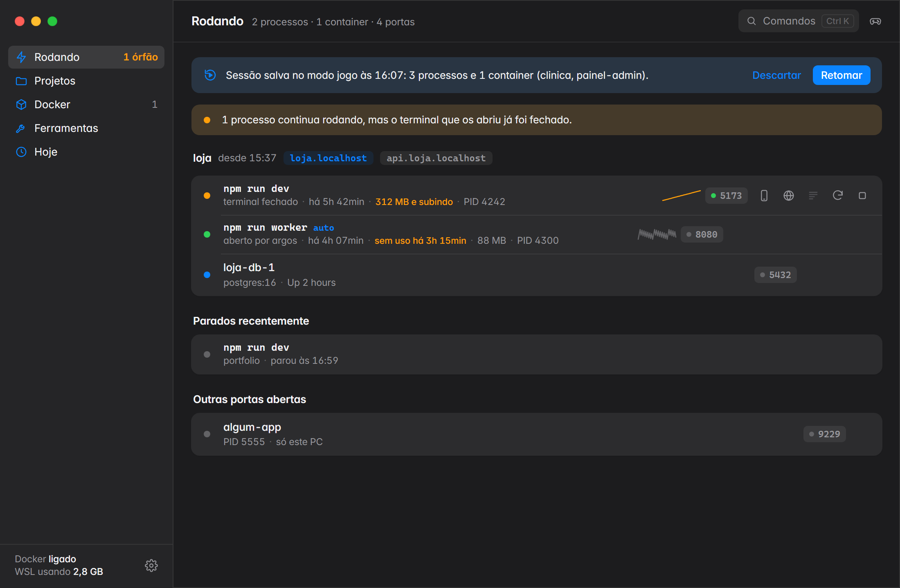

## Sumário

- [Instalação](#instalação)
- [Primeiros passos](#primeiros-passos)
- [Telas do app](#telas-do-app)
- [Comandos de terminal](#comandos-de-terminal)
- [argos.toml: subir um projeto inteiro](#argostoml-subir-um-projeto-inteiro)
- [Detecção de projetos e comandos](#detecção-de-projetos-e-comandos)
- [Portas fixas e endereços com nome](#portas-fixas-e-endereços-com-nome)
- [Integração com o Claude Code (MCP)](#integração-com-o-claude-code-mcp)
- [Configurações](#configurações)
- [Onde ficam os dados](#onde-ficam-os-dados)
- [Como funciona](#como-funciona)
- [Desenvolvimento](#desenvolvimento)
- [Limitações](#limitações)
- [Licença](#licença)

## Instalação

Requisitos: Windows 10 ou 11. Não precisa de Python instalado.

1. Baixe o `argos-<versão>.zip` na página de [Releases](../../releases).
2. Extraia o zip em qualquer pasta.
3. Dê dois cliques em `instalar.bat`.

O instalador:

- copia o app para `%LOCALAPPDATA%\argos\app` (não pede administrador);
- coloca o comando `argos` no PATH do usuário (abra um terminal novo depois);
- cria um atalho no Menu Iniciar e uma entrada em Configurações > Aplicativos;
- faz o app abrir junto com o Windows, escondido na bandeja.

Para remover, use Configurações > Aplicativos > Argos > Desinstalar, ou `desinstalar.bat` no zip. As configurações e logs em `%LOCALAPPDATA%\argos` são mantidos, a menos que você apague a pasta.

Para usar sem instalar, abra `app\argos-app.exe` direto da pasta extraída.

## Primeiros passos

1. Abra o painel com `Ctrl+Alt+D` ou clicando no ícone da bandeja.
2. Por padrão, cada subpasta de `Área de Trabalho\projetos` é tratada como um projeto. Se seus projetos ficam em outro lugar, ajuste em Configurações (engrenagem no canto inferior esquerdo).
3. Na aba Projetos, clique em um projeto e depois no comando que quer rodar.
4. Para rodar algo pelo terminal sem perder o controle depois de fechá-lo:

```
argos rodar npm run dev
```

O processo continua rodando mesmo que o terminal seja fechado, e a saída fica salva para consulta no painel ou com `argos logs`.

## Telas do app

### Rodando

Lista tudo que está ligado, agrupado por projeto. Para cada processo aparecem as portas (com indicação de site ou API), o tempo rodando, a memória e quem abriu o processo.


Avisos que aparecem nessa tela:

- Processo órfão: o terminal que abriu o processo foi fechado e ele continua rodando.
- Memória subindo: o uso de memória cresce de forma contínua (possível vazamento).
- Sem uso: o servidor está há horas sem nenhuma conexão.
- Sessão salva: o que estava rodando antes do modo jogo, com o botão Retomar.

Cada linha tem atalhos para abrir no celular (QR code), criar um link público, ver os logs, reiniciar e parar.

### Projetos

Os projetos aparecem em cards. Os que estão rodando ficam em cima, separados, com as portas e os botões de reiniciar e parar. Os parados mostram linguagem, branch do Git, alterações pendentes, variáveis de ambiente faltando e o resultado dos últimos testes.

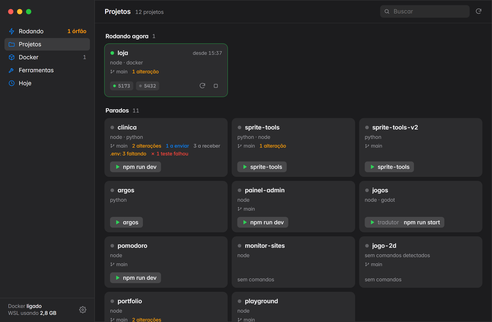

Clicar em um card abre a página do projeto:

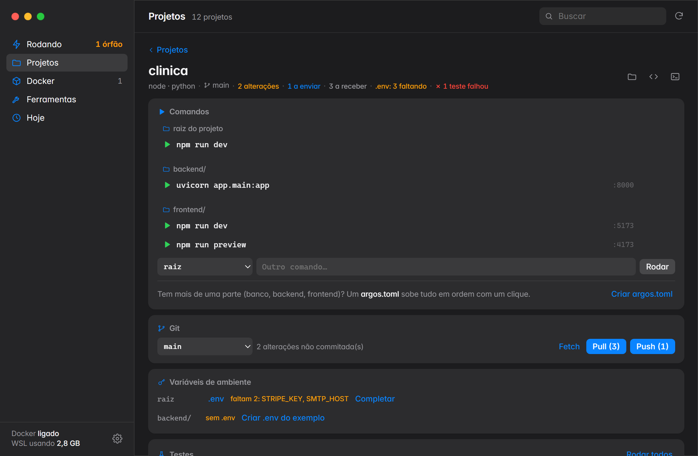

- Comandos: os detectados no projeto, agrupados pela pasta onde rodam (raiz, `backend/`, `frontend/`). O botão principal do card é o último comando usado, ou o que você fixar com o alfinete.
- Outro comando: roda qualquer comando na pasta escolhida. Ele fica na lista como recente.
- Apagar e restaurar: o X ao lado de um comando o tira da lista sem mexer nos arquivos do projeto. Os apagados aparecem riscados e voltam com um clique.
- Porta: clique no número da porta para escolher outra.
- Git: Fetch, Pull, Push e troca de branch. Clicar na branch (no card, no topo da página ou na seção Git) abre um seletor com busca, que lista as branches locais e as que só existem no servidor, e cria uma branch nova a partir da atual. Escolher uma branch do servidor baixa a branch e a deixa ligada à remota. Se o projeto estiver rodando, o aviso oferece reiniciá-lo.
- Variáveis de ambiente: abre o `.env` para editar e aponta o que falta em relação ao `.env.example`, com opção de completar.
- Testes: detecta e roda os testes do projeto, com o resultado e o log.
- Dependências: mostra o espaço ocupado por `node_modules` e `.venv`, com opção de apagar.

Quando o projeto está rodando, a página mostra uma faixa com as portas, os endereços com nome e os botões de reiniciar e parar:

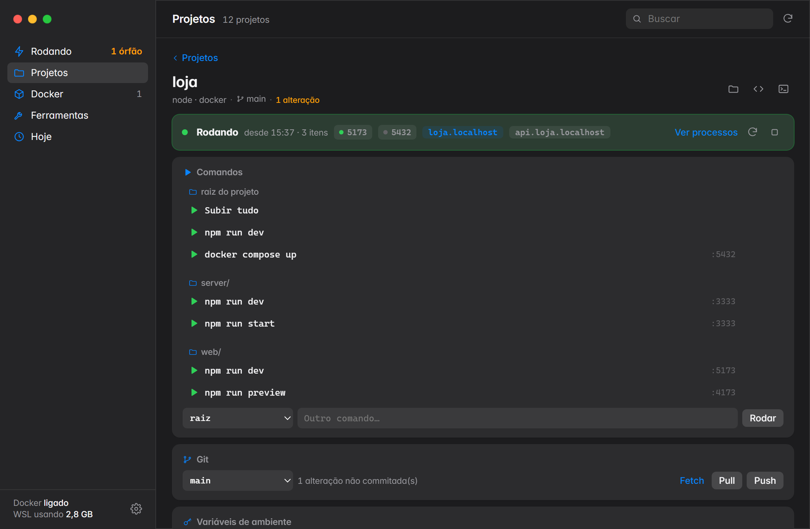

### Logs

Saída do processo em tempo real, com cores, busca (`Ctrl+F`), filtro para mostrar só erros e botão de copiar. Funciona para processos iniciados pelo Argos e para containers Docker.

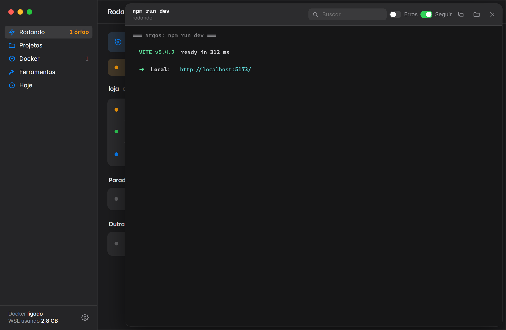

### Abrir no celular

Gera um QR code com o endereço do servidor na rede local. Se o servidor só aceita conexões do próprio PC, o app mostra como liberar (por exemplo, `--host` no Vite).

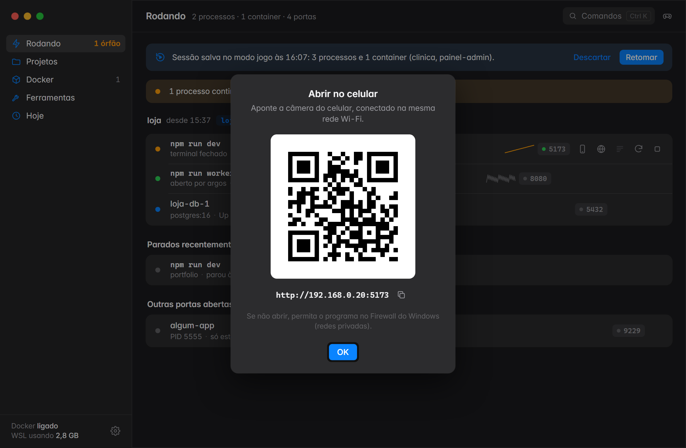

### Paleta de comandos

`Ctrl+K` abre uma busca por projetos, comandos, processos e ações (iniciar, parar, abrir logs, modo jogo).

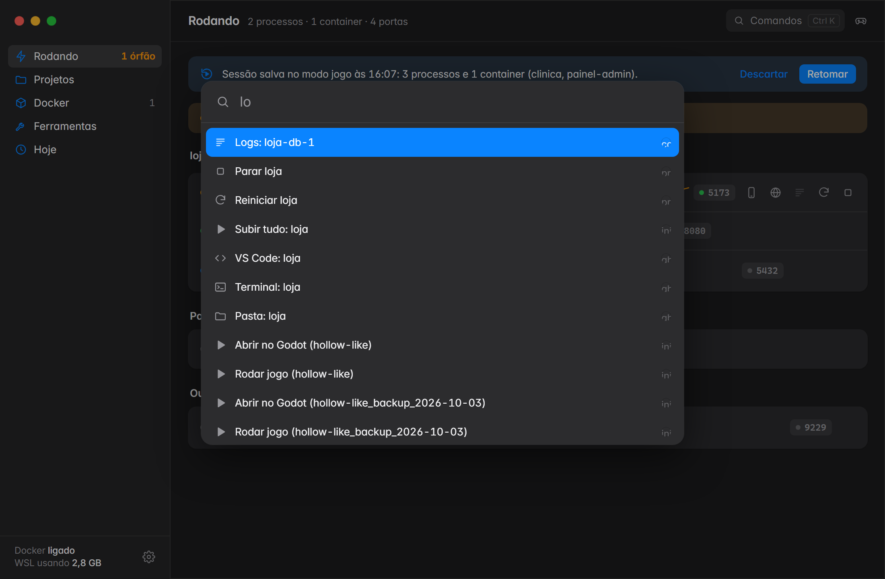

### Docker

Containers agrupados pelo projeto do docker-compose, uso de disco (imagens, volumes, cache) com opção de limpar, memória usada pelo WSL e botões para ligar e desligar o Docker Desktop.

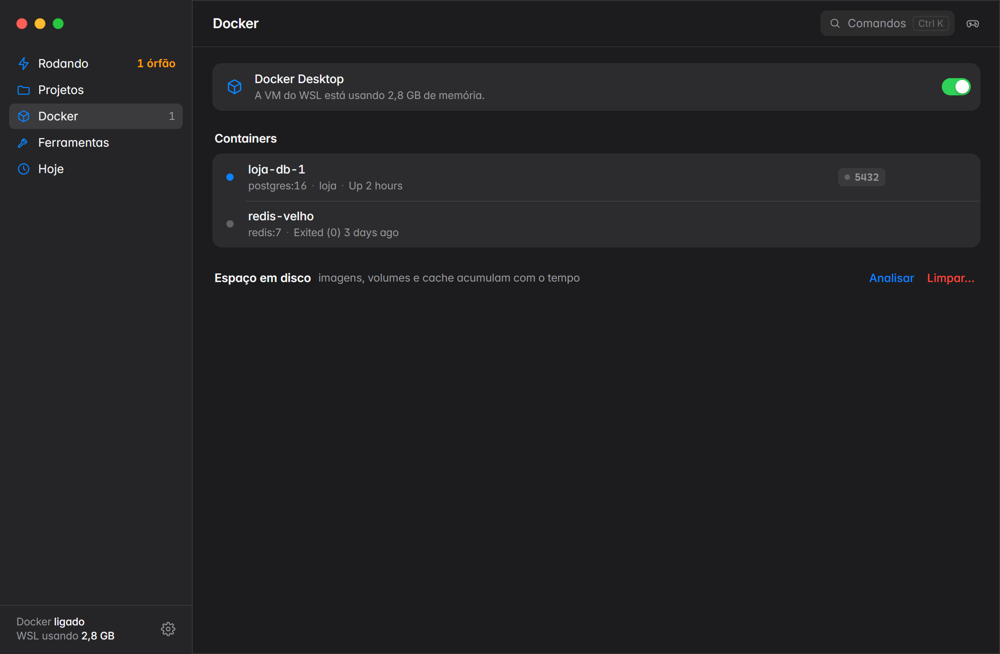

### Ferramentas

Processos de ferramentas que rodam em segundo plano, como servidores MCP abertos por editores e assistentes de código. Mostra quantas instâncias de cada uma existem, a memória total e quais ficaram órfãs depois de o programa que as abriu ser fechado.

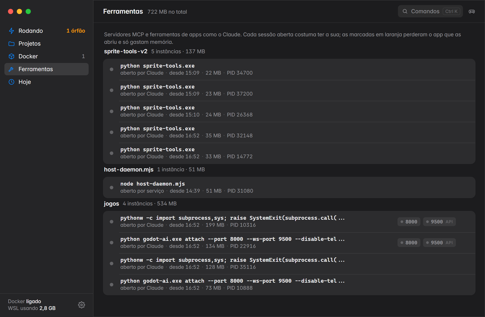

### Hoje

Histórico do dia: o que rodou, por quanto tempo e quando parou.

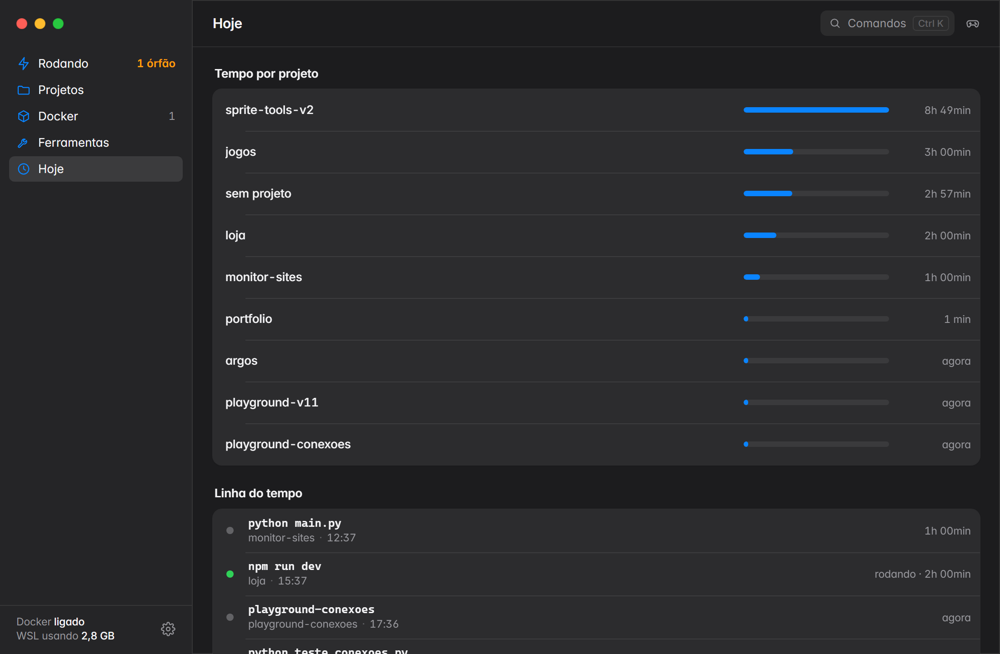

### Bandeja

O ícone muda de cor conforme o estado:

| Cor | Significado |
|---|---|
| Cinza | nada rodando |
| Verde | algo rodando |
| Âmbar | existe processo órfão |

O menu do ícone permite iniciar, reiniciar e parar projetos sem abrir a janela, ativar o modo jogo e abrir a pasta de logs.

### Notificações

O app avisa quando:

- um servidor termina de subir (com botão para abrir no navegador);
- um processo cai (com as últimas linhas do log);
- um servidor fica muito tempo sem uso;
- chegam commits novos no repositório remoto de um projeto;
- existe uma versão nova do Argos.

Processos marcados com reinício automático sobem de novo sozinhos se caírem, até 3 vezes em 10 minutos.

## Comandos de terminal

```
argos                        mostra Docker, processos, portas e ferramentas
argos --tudo                 inclui os processos das ferramentas

argos rodar <comando>        roda com logs; fechar o terminal não para o processo
                             --junto: para junto com o terminal
                             --auto: reinicia sozinho se cair
argos subir <projeto>        sobe tudo do argos.toml em ordem (--criar gera um modelo)
argos celular [porta]        QR code para abrir o servidor no celular
argos logs <alvo>            acompanha os logs (id, PID, porta, projeto ou container)
argos reiniciar <alvo>       reinicia (porta, PID, id ou projeto) mantendo pasta e variáveis
argos parar <projeto>        para containers e processos do projeto
argos porta <n>              encerra quem está usando a porta
argos matar <PID>            encerra o processo e os filhos

argos projetos               lista os projetos e como iniciar cada um
argos iniciar <projeto> [n]  inicia o projeto (comando n da lista; --fixar torna o principal)

argos docker [limpar]        disco e RAM do Docker; limpar libera espaço
argos docker ligar|desligar  liga ou desliga o Docker Desktop
argos modo-jogo              para tudo, salva a sessão e desliga o Docker (--wsl, --sem-lembrar)
argos retomar [id]           sobe de novo o que estava rodando (sessão salva)
argos sessao [salvar nome]   lista ou salva sessões

argos tunel <porta>          link público temporário (https://...trycloudflare.com)
argos testar <projeto>       roda os testes do projeto
argos atualizar              instala a versão nova do Argos, se houver
argos mcp --instalar         registra o Argos como ferramenta do Claude Code

argos app                    abre o painel
argos config                 abre o arquivo de configuração
argos ajuda                  lista todos os comandos

-f                           não pede confirmação
```

Exemplos:

```
argos rodar npm run dev          # inicia e pode fechar o terminal
argos logs 5173                  # logs de quem está na porta 5173
argos reiniciar loja             # reinicia todos os processos do projeto "loja"
argos porta 3000 -f              # libera a porta 3000 sem perguntar
argos modo-jogo --wsl            # para tudo e desliga Docker e WSL para liberar memória
argos retomar                    # sobe de novo o que o modo jogo parou
```

Reiniciar um processo que foi aberto fora do Argos copia o comando, a pasta e as variáveis de ambiente do original. A partir daí os logs passam a ser capturados.

## argos.toml: subir um projeto inteiro

Para projetos com várias partes (banco, backend, frontend), um `argos.toml` na pasta do projeto define o que subir, em que ordem e como saber que cada parte está pronta. O botão Subir tudo no app, ou `argos subir <projeto>`, executa esse arquivo.

`argos subir <projeto> --criar` (ou o botão Criar argos.toml) gera um modelo com os comandos detectados.

```toml
[[servico]]
nome = "banco"
docker = "db"                           # serviço do docker-compose ("*" = todos)
pronto = "porta:5432"

[[servico]]
nome = "backend"
cmd = "uv run uvicorn app.main:app --reload --port 8000"
pasta = "backend"
pronto = "http://localhost:8000/docs"
depois = ["banco"]
auto = true

[[servico]]
nome = "frontend"
cmd = "npm run dev"
pasta = "frontend"
depois = ["backend"]
```

| Campo | Descrição |
|---|---|
| `nome` | nome da parte, usado em `depois` e no painel |
| `cmd` | comando a rodar |
| `docker` | serviço do docker-compose a subir no lugar de um comando |
| `pasta` | pasta onde o comando roda, relativa ao projeto |
| `depois` | partes que precisam estar prontas antes desta começar |
| `pronto` | como saber que subiu: `porta:N`, uma URL `http://...` que responda, ou `log:texto` que apareça na saída |
| `auto` | reinicia sozinho se cair |

Arquivos `devs.toml` (nome usado em versões antigas) continuam funcionando.

## Detecção de projetos e comandos

Cada subpasta das pastas de projetos configuradas vira um projeto. O Argos lê os arquivos da raiz do projeto e das subpastas de primeiro nível (como `frontend/` e `backend/`; em monorepos, também `apps/*`, `packages/*` e `services/*`) para montar a lista de comandos. Pastas como `src`, `dist`, `tests`, `node_modules` e `.venv` são ignoradas.

| Arquivo | Comandos |
|---|---|
| `package.json` | scripts `dev`, `start`, `serve`, `preview` e `watch`, com npm, pnpm, yarn ou bun conforme o lockfile |
| `manage.py` | `python manage.py runserver` (Django) |
| FastAPI em `app/main.py`, `src/main.py`, `main.py`... | `uvicorn modulo:app --reload --port N` |
| `main.py`, `app.py`, `server.py` | `python main.py` |
| `pyproject.toml` com `[project.scripts]` | cada script declarado |
| `compose.yaml`, `docker-compose.yml` | `docker compose up -d` |
| `go.mod` | `go run .` e `go run ./cmd/<nome>` |
| `Cargo.toml` | `cargo run` |
| `*.csproj`, `*.fsproj` | `dotnet watch run` e `dotnet run` |
| `artisan` | `php artisan serve` (Laravel) |
| `composer.json` com `public/index.php` | `php -S localhost:8000 -t public` |
| `pom.xml` com Spring Boot | `mvn spring-boot:run` |
| `build.gradle` | `gradle bootRun` (Spring) ou `gradle run` |
| `deno.json` | `deno task dev`, `start` e afins |
| `bin/rails` | `rails server` |
| `Makefile` | alvos `dev`, `run`, `start`, `serve` e `up` |
| `project.godot` | abrir no editor do Godot e rodar o jogo |

Em projetos Python com `uv.lock`, os comandos rodam com `uv run`.

Testes são detectados da mesma forma: script `test` do `package.json`, `pytest` (pasta `tests/` ou dependência), `go test`, `cargo test`, `dotnet test` e `make test`. O resultado vem do código de saída do comando. Os testes rodam com `CI=true` para que Jest e Vitest terminem em vez de ficar observando arquivos.

A porta de cada processo é classificada como site ou API pela pasta onde ele roda (`frontend/`, `web/` e `client/` são site; `backend/`, `api/` e `server/` são API) ou pela ferramenta que a abriu (Vite, Next, Astro e afins são site; uvicorn, Flask, Django, Express, Nest e afins são API). Quando nenhum dos dois resolve, decide o tipo de conteúdo da resposta HTTP.

## Portas fixas e endereços com nome

Portas fixas: cada comando recebe uma porta que não muda entre execuções, passada para a ferramenta (`--port N --strictPort` no Vite, `-p N` no Next, `--port N` no uvicorn, `runserver N` no Django e a variável `PORT` nos demais). Sites ficam na faixa 5173 a 5299 e APIs na faixa 8000 a 8099. Para escolher outra, clique na porta na página do projeto.

Endereços com nome: o app mantém um proxy local na porta 80 (ou 8088, se a 80 estiver ocupada):

| Endereço | Destino |
|---|---|
| `http://loja.localhost` | site do projeto `loja` |
| `http://api.loja.localhost` | API do projeto `loja` |
| `http://5173.loja.localhost` | porta específica do projeto |
| `http://localhost` | lista do que está rodando |

O proxy repassa conexões WebSocket, então o recarregamento automático do Vite e similares continua funcionando. Navegadores resolvem `*.localhost` para o próprio PC sem configuração.

## Integração com o Claude Code (MCP)

O Argos pode ser registrado como servidor MCP no Claude Code, o que permite ao assistente consultar e controlar os processos de desenvolvimento:

```
argos mcp --instalar
```

Ou pelo botão Conectar em Configurações. Ferramentas expostas: `status`, `projetos`, `logs`, `iniciar`, `reiniciar`, `parar`, `subir` e `testar`.

## Configurações

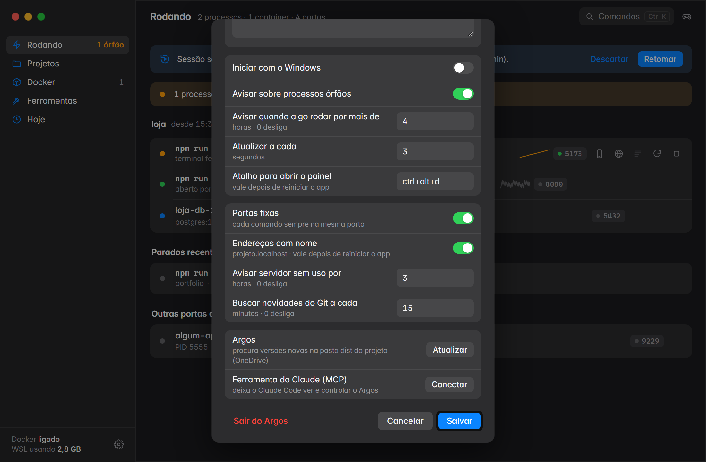

| Opção | Padrão | Descrição |
|---|---|---|
| Pastas de projetos | `Área de Trabalho\projetos` | cada subpasta vira um projeto |
| Iniciar com o Windows | ligado | abre escondido na bandeja |
| Avisar sobre processos órfãos | ligado | |
| Avisar quando algo rodar por mais de | 4 horas | 0 desliga |
| Atualizar a cada | 3 segundos | intervalo de atualização do painel |
| Atalho para abrir o painel | `ctrl+alt+d` | |
| Portas fixas | ligado | |
| Endereços com nome | ligado | proxy `*.localhost` |
| Avisar servidor sem uso por | 3 horas | 0 desliga |
| Buscar novidades do Git a cada | 15 minutos | 0 desliga |

As opções ficam em `%LOCALAPPDATA%\argos\config.json` (`argos config` abre o arquivo).

### Link público

`argos tunel <porta>` ou o ícone de globo cria um endereço `https://...trycloudflare.com` acessível de qualquer lugar enquanto o túnel estiver aberto. Usa o [cloudflared](https://developers.cloudflare.com/cloudflare-one/connections/connect-networks/), que o app oferece instalar pelo winget na primeira vez. Não precisa de conta na Cloudflare.

### Atualização entre máquinas

O app procura versões novas em uma pasta configurável (`pasta_atualizacao` no `config.json`). Por padrão é a pasta `dist` deste repositório dentro da pasta de projetos. Se essa pasta for sincronizada (OneDrive, Dropbox), basta gerar um zip novo em uma máquina para as outras oferecerem a atualização.

## Onde ficam os dados

Tudo fica em `%LOCALAPPDATA%\argos`:

| Arquivo | Conteúdo |
|---|---|
| `config.json` | configurações |
| `registro.json` | processos iniciados pelo Argos (comando, pasta, variáveis, log) |
| `preferencias.json` | comando fixado, recentes, apagados e portas fixas de cada projeto |
| `sessoes.json` | sessões salvas pelo modo jogo |
| `testes.json` | resultado dos últimos testes |
| `historico.jsonl` | histórico usado na aba Hoje |
| `logs\` | saída de cada processo |
| `app.log` | log do próprio app |

O Argos não envia dados para nenhum serviço próprio. As conexões externas são as dos seus repositórios Git (fetch, pull e push), o túnel quando você cria um e o winget ao instalar o cloudflared.

## Como funciona

- `argos/core/coleta.py`: lê a lista de processos do Windows (Toolhelp32 e psutil) e agrupa cada árvore (`npm` > `cmd /c` > `node vite`) em uma unidade. O projeto vem da pasta de trabalho ou da linha de comando; quem abriu o processo vem da cadeia de processos pais.
- `argos/core/registro.py`: processos iniciados pelo Argos. Um lançador intermediário (`argos _lancar`) inicia o processo e sai em seguida. Assim, fechar o terminal, mesmo encerrando a árvore inteira, não alcança o processo. A saída vai para `logs\`.
- `argos/app/monitor.py`: laço em segundo plano que detecta quedas, servidores prontos, uso de memória, servidores sem uso, novidades do Git e versões novas.
- `argos/app/proxy.py`: proxy TCP (asyncio) que roteia pelo cabeçalho `Host`.
- `argos/app/`: interface em HTML, CSS e JavaScript, exibida com pywebview (WebView2), e ícone de bandeja com pystray.
- `argos/mcp.py`: servidor MCP por stdio (JSON-RPC).
- `argos/plataforma/`: tudo que é específico do Windows fica aqui.

## Desenvolvimento

Requisitos: Python 3.12 ou mais novo e [uv](https://docs.astral.sh/uv/).

```powershell
uv sync
uv run pytest
uv run python -m argos                 # CLI
uv run python -m argos.app.principal   # app
```

Se o projeto estiver em uma pasta sincronizada (OneDrive, Dropbox), é melhor manter o ambiente virtual fora dela:

```powershell
$env:UV_PROJECT_ENVIRONMENT = "$env:LOCALAPPDATA\argos\venv-dev"
```

Scripts:

| Script | O que faz |
|---|---|
| `instalar.ps1` | roda os testes, empacota com PyInstaller e instala nesta máquina (`-SemInicializacao` não cria o atalho de inicialização) |
| `empacotar\gerar_zip.ps1` | gera `dist\argos-<versão>.zip` com o app pronto, instalador, desinstalador e instruções |

Para lançar uma versão: altere `argos/__init__.py` e `pyproject.toml`, rode `instalar.ps1` e depois `empacotar\gerar_zip.ps1`.

## Limitações

- Só funciona no Windows. O código específico do sistema está isolado em `argos/plataforma/`, mas ainda não há implementação para macOS ou Linux.
- Processos abertos fora do Argos não têm logs até serem reiniciados por ele.
- Os endereços `*.localhost` dependem da porta 80 (ou 8088) estar livre.
- O link público depende do cloudflared e do serviço gratuito de túneis da Cloudflare.

## Licença

[MIT](LICENSE).
